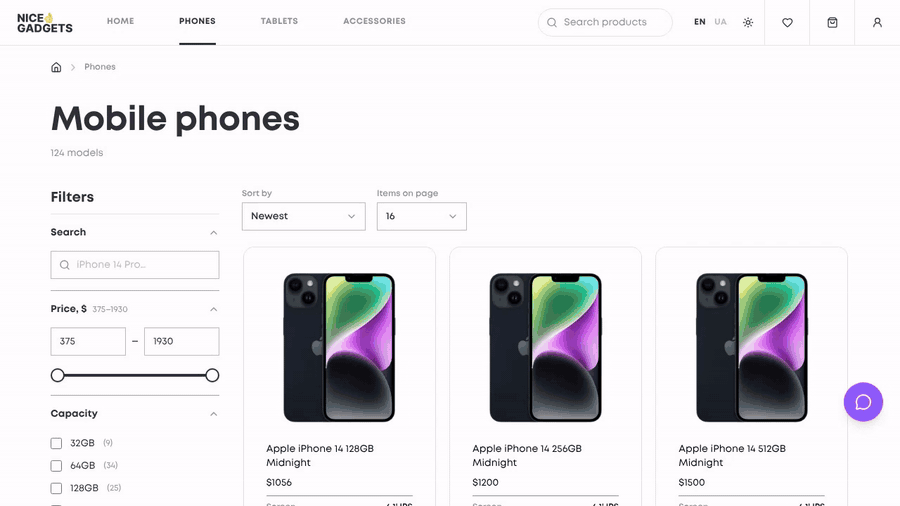
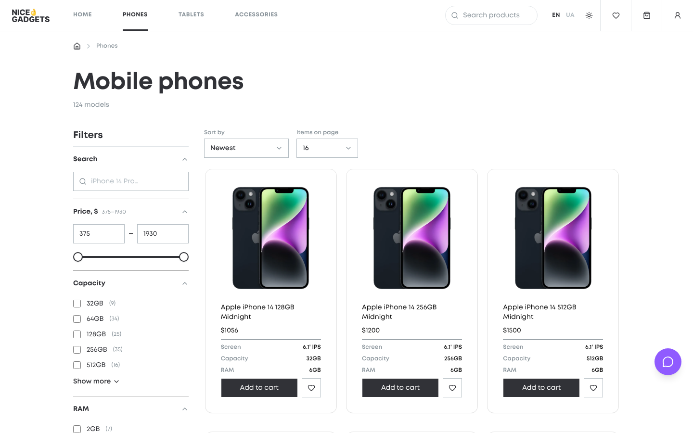

# Nice Gadgets

An online store for Apple phones, tablets and accessories. We built it as a team of four in two weeks for our team project at Mate Academy.

[Live demo](https://mate-team-group-5.github.io/simple-electronics-store/) | [Original team repository](https://github.com/Mate-Team-Group-5/simple-electronics-store)

To try the AI assistant, open the live demo and click the purple chat button in the bottom right corner. The first answer can take up to a minute while the free server wakes up.





## Tech stack

- Frontend: React 19, TypeScript, Vite, Tailwind CSS, React Router, Base UI, Motion
- Backend: Node.js, Express, PostgreSQL, JWT, Groq API
- Tools: ESLint, Prettier, Husky, GitHub Actions, Render, Jira

## My part

I was one of the frontend developers on the team. I started with the base of the project (design tokens, fonts, routing, header and footer), and after that I worked on most of the pages a customer goes through: catalog, search, checkout and the account pages. I also built the AI chat assistant, including the backend part for it.

In total I opened about 20 pull requests that were merged into the project.

### AI shopping assistant ([PR #57](https://github.com/Mate-Team-Group-5/simple-electronics-store/pull/57))

A chat where you can ask which phone or tablet to buy, and it suggests products from our store.

- I wrote the `/api/chat` endpoint on Express. It sends requests to the Groq API, and the API key stays on the server.
- The whole catalog goes into the prompt, so the bot only recommends things we actually sell, with real prices.
- When the bot mentions a product, the chat shows it as a card you can click.
- On a product page the chat knows which product you are looking at, so you can ask something like "is this phone good for photos?".
- It answers in English or Ukrainian, depending on the site language.
- I added checks on the incoming messages to prevent prompt injection, a timeout, and error messages for when the API is down or the limit is reached.

### Catalog ([PR #23](https://github.com/Mate-Team-Group-5/simple-electronics-store/pull/23), [PR #39](https://github.com/Mate-Team-Group-5/simple-electronics-store/pull/39))

- Sorting, pagination, and filters by price, memory, RAM and year.
- All filters are stored in the URL, so you can send someone a link with the same results, and the Back button works as expected.
- A price slider and filter groups made with Base UI.

### Search in the header ([PR #67](https://github.com/Mate-Team-Group-5/simple-electronics-store/pull/67))

- Searches across all categories and shows results in a dropdown with photo, name and price.
- Different colors and memory sizes of the same model show up as one result.
- The dropdown is accessible (ARIA combobox).
- Works with the keyboard (arrows, Enter, Escape). On mobile the search opens as a separate panel.

### Login, sign up and account ([PR #52](https://github.com/Mate-Team-Group-5/simple-electronics-store/pull/52))

- Login and sign up forms connected to our backend, with a JWT token.
- After signing up you are logged in automatically and sent back to the page you came from.
- Show/hide password, a password strength indicator and a Caps Lock warning.
- For logged-in users the checkout form is filled in automatically.

### Checkout ([PR #32](https://github.com/Mate-Team-Group-5/simple-electronics-store/pull/32))

- An order form with validation, a choice of delivery (Nova Poshta, courier or pickup), an order summary and a success screen.

### Other things

- English and Ukrainian versions of the site (i18n) with my own translation context in TypeScript.
- An animation where the product image flies into the cart or favorites icon.
- The home page banner slider and the "Shop by category" section.
- The favorites page.
- Bug fixes. The biggest one: prices on the product page and in the cart didn't match for 48 products, because they came from two different data sources.
- I reviewed my teammates' pull requests too. In one of them I found that the login response returned the password hash, and we fixed it.

## How we worked

We worked in Scrum with tasks in Jira. Each task had its own branch and pull request, and the team lead reviewed the code before merging. Before every commit Prettier and ESLint ran automatically.

## Team

- Vladyslav Hlukhov: team lead, backend
- Oleksandr Konovalenko: frontend (catalog, search, checkout, auth, translations, animations, AI assistant)
- Vasyl: frontend (product cards, dark theme, sliders)
- Yurii: frontend (product page, cart, Nova Poshta integration)

## How to run it locally

```bash
git clone https://github.com/slysahex/simple-electronics-store.git
cd simple-electronics-store
npm install
npm start
```

This starts the backend on port 3000 and the frontend on port 5173.

You will also need a `.env` file:

```
VITE_SERVER_URL=http://localhost:3000
DB_URL=postgresql://...
JWT_SECRET=...
GROQ_API_KEY=...
```

The AI chat needs the backend and a free Groq API key (`GROQ_API_KEY`).

To run only the frontend without a database, leave out `VITE_SERVER_URL` and start it with `npm run dev`. It will use the local JSON data.
